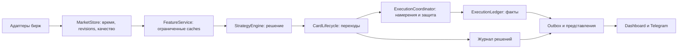

# Edge Hunter: план исправлений, рефакторинга ядра и изменения логики

> Обновление после внешнего аудита: очередность первой реализации и проверенные поправки описаны в [REVIEW_external_audit_2026-11-02.md](REVIEW_external_audit_2026-11-02.md). Все стратегии, включая Turtles, подлежат аудиту. Этот первоначальный документ сохраняется как история предложений, не как обязательная программа из 12 PR.

Подготовлено 2 ноября 2026 года. Статус: предложение к реализации; изменения кода, торговых правил и развёртывание не выполнялись. Приоритеты и критерии ниже — предлагаемые инженерные решения, а не результаты ещё не проведённых исследований.

Основание: [аудит исполнения и памяти](AUDIT_errors_memory_2026-11-02.md), действующий код `/opt/edgehunter` на `79d08d5`, read-only срез БД до 17:59:37 UTC и первичные веб-источники, проверенные 2 ноября. [Машиночитаемый срез](evidence/2026-11-02_plan_snapshot.json) содержит определения и оговорки. Срез БД позднее окна аудита логов; числа из этих окон не следует объединять как один синхронный снимок.

## 1. Решение и порядок работ

Работы идут тремя последовательными направлениями:

1. Стабилизировать потребление памяти, обработку событий и исполнение демо; сделать измеримыми причины задержек и состояния защиты.
2. Выделить из существующих модулей ядро с явными данными, временем, переходами состояний и побочными действиями. Переносить по одному компоненту, сравнивая со старым поведением.
3. Менять отбор сигналов, риск и выходы только отдельными версиями с заранее описанной проверкой. Ускорение и исправление данных могут менять набор реально доступных сигналов — такие различия надо регистрировать, а не объявлять автоматически чистым рефакторингом.

Для текущих 2 vCPU / 4 GiB первым ограничением служат ресурсы и надёжность. Повышение лимита памяти или числа workers без проверки увеличит конкуренцию и лишь отсрочит проявление накопления памяти. Целевой вариант — модульное приложение с ограниченными очередями и небольшим числом вычислительных процессов; распределённая система пока не обоснована измерениями.

## 2. Что говорят текущие данные

| Наблюдение | Что из него следует | Чего оно не доказывает |
|---|---|---|
| Private родителя 1679 → 3825 MiB с 01:03 до 17:15; structures около 0,8 GiB | Нужны поиск удержания памяти и контроль наклона после прогрева | Разность private/structures не равна доказанному размеру утечки |
| Swap почти заполнен; cgroup high=14665 при MemoryHigh=3 GiB | Нужны метрики всей службы, reclaim и доступного резерва | Не каждая пауза вызвана paging |
| 1882 паузы watchdog, максимум 6 с; scan до 7,98 с | Горячий цикл надо разгрузить и профилировать по этапам | Средний CPU не измеряет хвост задержки |
| В 947 паузах виден ind_panel в фоновом потоке; flow.py — в 744 | Сначала устранить повторную работу и конкуренцию за GIL | Любой перенос в новый процесс не гарантирует улучшения |
| 117 неудачных ожиданий Telegram lock; 24 исторических удаления по TTL | Нужен диспетчер с backoff и приоритетами | 117 неудачных попыток не равны 117 потерянным сообщениям |
| 64 OI-точки дают лишь 5 точек за 4 мин для запроса час назад | Нужен контракт исторического покрытия | Отрицательный age относительно trigger не доказывает ошибку часов |
| Из 162 новых demo rows только 54 с entry_fill; 108 пропущены | Карточки, попытки и исполнения должны иметь разные знаменатели | Нельзя считать 162 строки 162 исполненными сделками |
| Из этих 54 исполнений 26 закрыты, 28 открыты | Это малый и ещё незавершённый срез | Он не даёт вердикта о прибыльности стратегий |
| latency_ms: медиана 33,113 с, p95 69,667 с, max 74,048 с | Нужно разложить задержку и проверить сериализацию исполнителя | Это не чистый REST latency и не время до постановки стопа |
| У 594 entry rows quality=True; cost_r заполнен у 296 | Нужны полнота признаков и явный unknown | True по умолчанию не подтверждает качество всех входных данных |
| Сборка 79d08d5, журнал eng-169l | Нужны независимые версии сборки, данных и торговых правил | Не каждый инфраструктурный коммит обязан менять strategy_version |

`executor.reconcile_loop` проверяет лимитные исполнения раз в 10 секунд и под общей блокировкой. Комментарий кода прямо указывает: до обнаружения fill защитный стоп ещё не выставлен. Это **конструктивное окно риска**, а не измеренное число незащищённых позиций. Поле `no_stop` само по себе не годится для такого измерения: у Connors оно обозначает особую политику и код может выставлять отдельный катастрофический стоп.

В `journal._trade_rows` обучение P(trade) выбирает принятые entry-карточки с card_r, а `ml.trade_label` использует card_r_low/card_r. Отбор не привязан к наличию фактического demo fill. Следовательно, нынешняя цель модели — результат принятой карточки по её модели исполнения; её нельзя представлять как вероятность прибыльного исполнения на BingX. Это следует из кода, а не из оценки эффективности модели.

## 3. Этап A: воспроизводимая база и наблюдение — PR-01

**Приоритет P1. Зависимостей нет.**

Изменения:

- Начать ветку от работающего `79d08d5`. `/opt/edgehunter-dev` сейчас на `a55a08f`, поэтому разработка прямо поверх него потеряет часть уже работающих исправлений. Сохранить незакоммиченные тесты рабочего каталога и локальные настройки; не переносить их молча и не делать force-reset.
- Зафиксировать baseline: SHA, hash разрешённых настроек без секретов, версии зависимостей, runtime, число инструментов, карточек и подписок. Не печатать credentials и не хешировать низкоэнтропийные секреты для публикации.
- Добавить `build_sha`, `config_fingerprint`, `feature_schema_version`, `execution_model_version`, `strategy_version`, `decision_id`. Старые строки не переименовывать массово; для них сохранить unknown/legacy provenance.
- В `scanner.state_loop`, `watchdog`, `memreport` добавить RSS/PSS/swap родителя и workers; cgroup memory.current, memory.swap.current, прирост memory.events.high, PSI, MemAvailable; размеры caches/очередей и возраст самой старой работы.
- Разделить времена: event_ts, received_ts, decision_ts, queued_ts, submit_ts, ack_ts, fill_ts, protection_confirmed_ts. Длительности внутри процесса мерить monotonic, биржевые времена хранить отдельно с оценкой смещения часов.
- Ошибки классифицировать: input_missing, input_stale, historical_coverage_missing, rate_limited, timeout_unknown_outcome, invalid_request, invariant_violation. Счётчики всех повторов отделить от ограниченных по частоте WARNING.

**Обоснование источником:** Linux определяет memory.high как механизм throttling/reclaim, а не жёсткий предел и не событие OOM. Поэтому high и PSI нужны наряду с RSS. [Документация cgroup v2](https://docs.kernel.org/admin-guide/cgroup-v2.html#memory).

**Готовность:** снимок объясняет расход всей службы; latency разбита на этапы; аналитика различает build и strategy; старые данные сохраняют происхождение. Новые поля добавляются совместимо, без полной переписи 732 MiB signals.db.

## 4. Этап B: память и производительность — PR-02…04

### PR-02. Удержание памяти и GC

Файлы: `fetcher._hourly_candles_loop`, `fetcher.fetch_baselines`, `main`, `memreport`, `watchdog`.

1. В изолированном процессе на ограниченном фрагменте записанных данных сравнить текущую политику freeze с вариантом без периодического freeze. Сохранять число frozen-объектов и память между проходами. Гипотезу об аллокаторах проверять отдельно.
2. Убрать периодическое глобальное freeze при подтверждённой эквивалентности расчётов и приемлемых GC-паузах. Целевой вариант — обычное управление GC и меньший объём временных Python-объектов. Любое сохранённое freeze должно иметь конкретное обоснование и контролируемое время жизни.
3. Замеры глубоких Python/native allocations выполнять на диагностическом процессе, не на основном цикле. Устранить полную материализацию контейнеров ради маленькой выборки в approx_size.
4. После перезапуска проверять наклон полной памяти, а не только первоначальное снижение RSS. Если рост остался, продолжить поиск native-retained/fragmentation; не закрывать MEM-01 только удалением двух вызовов.

**Источник:** gc.freeze выводит все отслеживаемые объекты из будущих сборок; описанный Python сценарий экономии copy-on-write относится к fork. Здесь pools создаются через spawn. Это поддерживает пересмотр политики, но не доказывает её долю в росте бота. [Python GC](https://docs.python.org/3.14/library/gc.html#gc.freeze).

### PR-03. Свечи, cache и индикаторы

Файлы: `scanner._minute_candles`, `_FrameLookup`, `_panel_prewarm_loop`, `fetcher.indicator_panel`, `strategies.ind_panel`, `levels.resample`, `flow.RushOrders.stats`.

- Один согласованный снимок закрытых минут на symbol в рамках scan; его используют детекторы, сопровождение, подтверждения и уровни.
- Ввести revisions свечей/истории. Ключ cache учитывает symbol, timeframe, закрытый временной срез, revision и схему признаков. Пересмотренная REST-свеча обязана инвалидировать зависимые результаты.
- Хранить ограниченное число актуальных результатов на symbol/timeframe, вытеснять адресно. Убрать глобальный clear при >1200 ответах. Исторические запросы держать в отдельном ограниченном cache.
- Общие индикаторы считать один раз, направления применять к одному результату. Повторный запрос того же результата присоединяется к выполняющемуся расчёту, а не запускает второй.
- Prewarm планировать на изменение входа/закрытие свечи; новым карточкам и исправлениям истории разрешать адресный пересчёт. Polling каждые 20 секунд заменить контролируемым механизмом актуализации.
- Rush-метрики обновлять с учётом новых сделок и движения временного окна. Изменение секунды тоже может изменить ответ без новой сделки; простой cache только по trade-counter неверен.
- Инкрементальные EMA/ATR вводить лишь с доказанной эквивалентностью seed/warm-up/revision поведения. Для первой версии достаточно повторного использования полного расчёта.

**Источник:** asyncio.to_thread обычно помогает I/O, но не устраняет ограничение GIL для Python CPU-кода; некоторые native-функции GIL отпускают. Поэтому потоки допустимы по профилю работы, не по факту наличия await. [Python asyncio](https://docs.python.org/3.14/library/asyncio-task.html#asyncio.to_thread).

### PR-04. Вычислительный бюджет и завершение

- После PR-03 измерить остаток: если GIL-нагрузка всё ещё нарушает задержки, выполнять её ограниченными пакетами в существующем вычислительном контуре. Новый pool допустим только после оценки суммарной памяти и стоимости сериализации.
- Не накапливать одинаковые jobs: по ключу оставить актуальную ожидающую работу; выполняющийся результат принимать только при совпадении revision. Отмена asyncio-await не считается отменой уже начатой работы процесса.
- Один бюджет конкуренции для maps/indicators/ML; справедливый планировщик не допускает голодания карт и данных открытых позиций. Число jobs ограничить ещё до submit.
- При shutdown прекратить приём новых jobs, запретить recreation pools, отменить ожидающую работу и дождаться/завершить начатую по определённому сроку. Сохранить outbox/неопределённые заявки, затем закрыть соединения.
- Автоматический recycle workers рассматривать лишь при измеренном росте именно worker, не как лечение утечки родителя.

Ограничения сериализации и жизненного цикла процессов описаны в [ProcessPoolExecutor](https://docs.python.org/3.14/library/concurrent.futures.html#processpoolexecutor). Это обосновывает ограниченный планировщик, а не конкретное число workers.

## 5. Этап C: исполнение и доставка — PR-05…07

Работы PR-05 и метрики защиты из PR-01 имеют P1 и могут предшествовать глубокому рефакторингу. Исторический PnL не нужен, чтобы исправлять неопределённое состояние заявки.

### PR-05. Явные намерения, исполнение и защита

Файлы: `executor.on_entry`, `_open`, `_resolve_unknown_entry`, `check_limits`, `_limit_filled`, `_place_stop`, `reconcile_loop`; новые `core/execution_types.py`, `execution/ledger.py`.

- Передать в фоновое исполнение неизменяемый снимок намерения с decision_id, entry/stop/targets и revision. Текущий TrackedSignal изменяется, пока фоновая задача ждёт общую блокировку; это риск чтения уже другого состояния, требующий фиксации контракта.
- Сохранить намерение и связь clientOrderId до внешнего side effect. Существующие clientOrderId и поиск неизвестного исхода сохранить и проверить; создавать их заново «для надёжности» поверх имеющейся реализации не требуется.
- Для неизвестного исхода тайм-аута сначала reconciliation по ID/ордеру/позиции. Не повторять create как будто отказ уже доказан. Доставка событий допускает повторы; обработка должна их распознавать. Сквозное exactly-once между SQLite и биржей не обещать.
- Раздельно хранить состояние заявки, фактической позиции и защиты. Частичный fill и подтверждённый стоп — разные факты. Не определять защищённость только по no_stop или успешному ответу отправки.
- Ограничить время удержания общей блокировки: резервирование монеты и риска — короткая атомарная операция; ожидание сети — вне неё при наличии состояния in_flight. Сначала воспроизвести гонки, только потом менять блокировки. Ускорение без резервирования вернёт уже исправленную двойную заявку на монету.
- Приоритизировать защиту/закрытие над новыми входами. Объём защиты согласовать с реально исполненным объёмом и режимом позиции.
- Проверить поддержку биржей связанных защитных ордеров и событий исполнений на текущем BingX API/CCXT. Если нужный режим недоступен, явно измерять и ограничивать окно до защиты; не объявлять его нулевым. Опцию не считать подтверждённой только по наличию похожего API у Binance.
- Разделить попытки, пропуски, неопределённые заявки и исполненные сделки в отчётах и знаменателях win rate/latency.

**Источник:** CCXT разделяет precision и minimum limits; округлённое количество ещё обязано удовлетворять лимитам amount/cost. Проверять оставшийся объём после partial перед каждой следующей заявкой. [CCXT Precision and Limits](https://github.com/ccxt/ccxt/wiki/Manual#precision-and-limits).

**Критерии:** при повторе события/перезапуске не появляется вторая позиция; тайм-аут не теряет неизвестную заявку; защитный статус сверяется с биржевыми фактами; quantity-путь не пытается бесконечно отправлять нулевой/dust-остаток. Фактические пределы времени до защиты выбрать после PR-01, как отдельную политику риска.

### PR-06. Очередь Telegram

Файлы: `notifier`, `storage`; отдельный диспетчер доставки.

- Ограниченная очередь в RAM, долговечный outbox для критичных событий. PNG и старые сводки не держат бесконечное число задач.
- Планировщик по chat с общим бюджетом bot; forum topics не считать независимыми chat с независимыми лимитами без подтверждения API.
- Защита/ошибки исполнения выше входов; входы выше сводок. Порядок внутри карточки сохраняется; устаревшее объединяется только когда семантика допускает. Критичное событие не исчезает молча при переполнении.
- Backoff 429 переносит время следующей попытки и освобождает общий ресурс. retry_after обязателен к учёту; повторная отправка в тот же ограниченный chat раньше срока запрещена, даже для приоритетного сообщения.
- Если долговечное сохранение критичного события не удалось, это отдельная наблюдаемая неисправность. Доставка Telegram не служит подтверждением исполнения/защиты позиции.

[Telegram FAQ](https://core.telegram.org/bots/faq#my-bot-is-hitting-limits-how-do-i-avoid-this) описывает ограничения на chat/group/broadcast; [Bot API retry_after](https://core.telegram.org/bots/api#responseparameters) — срок ожидания при flood control. Диспетчер — наше решение с учётом этих ограничений. Реальный scope конкретного 429 консервативно учитывать, а не обходить параллельными отправками.

### PR-07. Журнал, outbox и восстановление

- События изменения execution ledger и его outbox записывать одной транзакцией **в одной БД**. Отдельные signals.db и demo_trades.db не образуют общей атомарной транзакции; аналитику между ними соединять через стабильные IDs и восстанавливаемую проекцию.
- Один управляемый writer на БД, ограниченные очереди записей, короткие транзакции. Состояния заявки/защиты приоритетнее аналитических снимков. DB-подтверждение критичного события асинхронно ожидать до перехода, где оно необходимо.
- Dashboard и исследовательские чтения — через отдельные read-only connections/снимки с ограниченным временем транзакции. Измерять commit latency, очередь и WAL; рост WAL не лечить VACUUM на действующем процессе.
- Бэкап через SQLite backup API; проверить восстановление на отдельной копии, а не только существование файла.

SQLite WAL допускает параллельных читателей, но только одного писателя; долгие чтения могут мешать завершению checkpoint. Поэтому число потоков не заменяет протокол записи. [SQLite WAL](https://www.sqlite.org/wal.html), [Online Backup API](https://www.sqlite.org/backup.html).

## 6. Этап D: корректность времени и данных — PR-08…09

### PR-08. Покрытие OI и состояние входных данных

- Формализовать `as_of` и доступность: биржевое время значения, время получения и предел среза различаются. Исторически исправленная свеча не должна изображаться как уже известная в старом решении.
- Рассчитать глубину хранения по контракту: `retention >= feature_lookback + max_supported_trigger_delay + delivery_margin`, а число точек — по частоте источника. Последние два параметра определить из распределения задержек и правил стратегий; не выбирать 128/256 точек наугад.
- Внести типы valid/missing/stale/insufficient_history/revised, timestamp/coverage/venue для каждого важного признака. Один data_quality_ok не описывает одновременно поток, стакан, свечи и OI.
- Изменить семантику записи отсутствующего качества с implicit True на unknown. Это миграция данных; старое True нельзя автоматически переинтерпретировать как подтверждённое качество.
- Для каждого strategy/playbook задать обязательные и вспомогательные данные. Missing обязательного входа означает «не могу оценить» с причиной; отсутствующий необязательный признак не превращается автоматически в bearish или veto.
- Сначала shadow-сравнение: сколько решений меняется из-за новой полноты/retention. Переход от допуска при None к блокировке — отдельное изменение торговой логики.

Binance требует последовательного применения diff по U/u/pu и повторной синхронизации при разрыве. Поэтому при overflow нельзя произвольно выбросить depth delta и продолжить считать стакан валидным. [Binance local order book](https://developers.binance.com/en/docs/products/derivatives-trading-usds-futures/websocket-market-streams/How-to-manage-a-local-order-book-correctly).

### PR-09. Метки, аналитика и ML

- Развести card_outcome, replay_outcome и exchange_realized_outcome. Card R и фактический PnL после комиссий/funding имеют разные источники и смысл.
- Текущую модель определить как P(card). Для P(executed_trade) использовать только подтверждённые исполнения с достаточными данными результата; это меняет выборку и требует отдельной оценки. При нехватке данных оставить shadow.
- Для обучения хранить label_available_at. В `warm_start_trades` не подменять неизвестный exit_ts временем entry для оценки out-of-sample: такие строки исключать из временного scoring либо восстанавливать время с явным provenance.
- Проверить совместимость feature schemas и execution models между версиями, а не смешивать последние 30 дней только ради числа строк.
- Оценивать предсказания, записанные **до** появления метки, против константной вероятности и простого baseline. Проверять log loss/Brier и reliability diagrams; отдельно оценивать net expectancy выбранных решений.

Калибровка означает соответствие вероятностей наблюдаемым частотам; один Brier не изолирует калибровку от разделяющей способности. [scikit-learn calibration](https://scikit-learn.org/stable/modules/calibration.html). Это обоснование проверки, а не довод включить ML как фильтр.

## 7. Этап E: новое ядро по частям — PR-10…12

Сейчас шесть модулей scanner/fetcher/executor/journal/signal_book/stats занимают 12367 строк. Размер сам по себе не дефект; проблема в том, что mutable-состояние и side effects пересекают асинхронные границы.

Целевая граница ответственности:

### PR-10. Контракты и владение

Предлагаемые новые границы пакетов: `core/types.py`, `market/store.py`, `features/service.py`, `core/card_lifecycle.py`, `execution/coordinator.py`, `execution/ledger.py`, `delivery/dispatcher.py`. Имена можно уточнить при переносе; ответственность должна остаться явной.

- MarketStore — единственный владелец mutable рыночного состояния; наружу выдаёт компактные согласованные снимки.
- StrategyEngine получает данные и выдаёт решение/причины без REST/SQLite/Telegram внутри.
- CardLifecycle описывает переходы WATCH/ZONE/ENTRY/… и события, но не отправляет заявки сам.
- ExecutionCoordinator обрабатывает намерения с учётом режима позиции и резервов; Ledger хранит факты. Карточка не является достоверным состоянием биржи.
- Представления читают проекции и не инициируют побочные действия через обычный запрос просмотра.

Состояния заявки, позиции и защиты ортогональны. Например, PARTIALLY_FILLED может сочетаться с PROTECTION_PENDING. Линейная цепочка «filled → protected → closed» недостаточна для поздних сообщений и частичных исполнений.

### PR-11. Контроль нагрузки и отказов

- Раздельные очереди критичного исполнения, market processing и фоновой аналитики; приоритеты не меняют порядок зависимых событий одной позиции.
- Приоритизировать открытые позиции и сопровождаемые карточки; потом новые сигналы; затем prewarm, картинки, сводки и ML-refit.
- При переполнении не терять экономические факты. Устаревшую аналитическую job можно объединить с новой; потерю delta отметить как необходимость resync. Потерю критичного события переводить в неисправность с восстановлением, а не скрывать.
- Поведение «при деградации запретить новые демо-входы, продолжая защиту/закрытие» — предлагаемая политика риска, требует отдельного решения и новой версии поведения.
- Universe budget учитывать pinned-инструменты и монеты открытых карточек: max_pairs=150 не означает жёстко 150 объектов. Урезать подписки открытой позиции ради соблюдения номинального лимита нельзя.

Ограниченная asyncio.Queue обеспечивает механизм обратного давления, но политика переполнения и приоритетов — наша ответственность. [Python Queues](https://docs.python.org/3.14/library/asyncio-queue.html).

### PR-12. Единое ядро live/replay

- Использовать один код вычисления признаков, построения плана и переходов карточки. Различаются clock, ввод событий и execution adapter.
- Записать небольшой набор реальных входных событий, включая revisions/gaps/reconnect/partial. Прогонять старый и выделяемый компонент на одинаковом вводе без отправки ордеров/Telegram.
- Для чистого рефакторинга решения, veto, entry/stop/targets и переходы должны совпадать. Любое различие получает объяснение и отдельный patch категории bugfix/logic.
- Сравнивать модель карточки с карточкой, а биржевое исполнение с фактами исполнения. OHLC-replay не восстановит очередь лимитной заявки и порядок событий внутри бара.
- Не писать всю историю raw depth в новый универсальный event log: объём/скорость не обоснованы. Для диагностики использовать ограниченный recorder и долговечные события решений/исполнений.

## 8. Этап F: изменение торговой логики — отдельная программа

Следующие пункты — кандидаты, не указание включить новые правила. Источники поддерживают механизмы или метод оценки, но не доказывают преимущество конкретного порога на крипте.

| Кандидат | Обоснование текущими данными | Проверка и условие принятия |
|---|---|---|
| L1. Просроченный trigger и обязательность данных | OI-контрпример, объединённая latency до 74 с, implicit quality=True | Shadow по strategy/TF; сравнить текущий допуск с заранее заданной политикой возраст/качество. Исправление наблюдаемости отдельно от включения veto |
| L2. Стоимость исполнения и допустимость входа | 54 fills; p95 slip 11,12 bps, но это VST, а база расчёта может отличаться по пути заявки | Разложить signal→quote→fill и комиссии/funding; сверить replay и фактические fills. Порог давности/цены выбирать после данных и проверки вне выборки |
| L3. Риск общего движения вместо счётчика карточек | 21 OVERLAP; текущий crowd_max=0, а история описывает прежний 17-часовой запрет входов при простом cap | Предложить лимит суммарного риска до стопов и общей экспозиции с учётом корреляции. Это выбор политики владельца; не включать новый лимит автоматически |
| L4. Выходы, зависящие от метода | Есть неодинаковые no_tp, partial 50% на +1R, trailing, card/exchange/replay outcomes | На одних входах сравнить действующие выходы и один заранее выбранный вариант на класс метода. Считать расходы и неоднозначные бары; все семейства, включая Turtles, проверять; изменение канонических правил отделять от исправления реализации |
| L5. Структурные stop/target вместо неподтверждённых глобальных порогов | PARAMETER_PROVENANCE маркирует ряд min_rr/ATR/1R-правил как heuristic/policy | Проверять по TF структуры и matched-placebo, с поправкой на перебор. Не возвращать глобальный TP1>=1R и произвольные ATR-пороги по небольшому текущему срезу |
| L6. ML как ранжирование/фильтр | P(card) и P(executed) сейчас смешиваются в названиях, shadow предсказания имеются | Сначала PR-09 и временная проверка; включение возможно только при устойчивом приросте net expectancy/калибровке и достаточной независимой выборке |

Исследование Cont–Kukanov–Stoikov связывает order-flow imbalance и краткосрочные изменения цен на данных акций NYSE. Это основание отдельно исследовать flow на коротком горизонте; оно не доказывает перенос эффекта на крипто-перпетуалы, многочасовые уровни или конкретный flow-veto. [The Price Impact of Order Book Events](https://arxiv.org/abs/1011.6402).

Проверить и обосновать выбор timeframe для целей/стопов; это рабочая гипотеза реализации, не ограничение аудита. Обновить PARAMETER_PROVENANCE по фактическому коду: документ проверял eng-143 и не является готовым описанием всех последующих изменений. Статьи и авторские методики не заменяют эмпирическую проверку параметров.

### Протокол каждого исследования

До запуска отдельный файл фиксирует вопрос, baseline, допустимые варианты, периоды, universe на соответствующую дату, расходы, primary metric, критерий успеха и правило остановки. Сейчас предлагается следующий протокол; он ещё не согласован как окончательное условие конкретного исследования.

1. Зафиксировать code/config/data/schema/execution versions и валидность replay. Исследования, признанные void в PLAN_server_eng76, не использовать как доказательство.
2. Хронологическое разделение: разработка на раннем периоде, walk-forward на последующих и последний закрытый период для итоговой проверки. Фильтрацию universe не строить по сегодняшним выжившим инструментам; учитывать листинги/делистинги.
3. Удалять из train события, чьи label intervals пересекают validation/test; величина purge/gap определяется реальным временем жизни метки. Для многодневных Turtles/Connors фиксированные 4 часа недостаточны. Обычный TimeSeriesSplit(gap=N) не заменяет этот разбор для нерегулярных событий.
4. Сравнивать парные решения/выходы на одном наборе входов; интервалы считать по зависимым рыночным блокам, проверяя достаточность длины блока. Для уровней — placebo вне реальных зон, сопоставленный по тренду/волатильности, с тем же бюджетом расходов.
5. Основной экономический результат — разность net expectancy после расходов, вместе с долей исполнений и хвостовым риском. Для вероятностей — дополнительно proper scores и reliability; AUC не заменяет экономический эффект.
6. Предлагаемый gate: нижняя граница заранее выбранного 95% доверительного интервала парной разности >0 на закрытом периоде, положительный результат после заранее выбранного stress-cost и отсутствие нарушения согласованного бюджета риска. Нужный effective sample size определить мощностью под минимально полезный эффект, а не «30 строк достаточно». Нехватка мощности означает недостаточно данных.
7. При нескольких гипотезах вести полный журнал попыток; определить семейство тестов и поправку до расчёта. BH q=0,05 не включать механически без проверки зависимости; при неподходящих предпосылках использовать более консервативную процедуру. Для большого перебора дополнительно PBO/DSR, не как замену временной проверке.
8. После согласования результата — ограниченный shadow-период; затем отдельная версия и сопоставимый forward-период без одновременной смены нескольких групп правил.

Хронологическое разделение обосновано [TimeSeriesSplit](https://scikit-learn.org/stable/modules/generated/sklearn.model_selection.TimeSeriesSplit.html); специфика interval-purge выше — наша схема под данные проекта. Риск выбора лучшего из множества backtests рассматривают [Bailey et al., Probability of Backtest Overfitting](https://www.davidhbailey.com/dhbpapers/backtest-prob.pdf); корректировку selection bias и ненормальности Sharpe — [Bailey & López de Prado, Deflated Sharpe Ratio](https://www.davidhbailey.com/dhbpapers/deflated-sharpe.pdf). Эти работы не гарантируют прибыль и не оправдывают выбранный порог входа.

## 9. Приёмка, поставка и откат

### Предлагаемые технические цели

Это начальные цели приёмки, выбранные для проекта, а не нормативы из документации:

| Область | Цель | Как измерять |
|---|---|---|
| Память | После прогрева рост <=10 MiB/час в 12-часовом окне; нет устойчивого роста swap и reclaim-pressure | Суммарный процессный PSS+SwapPSS и cgroup resident/swap отдельно, одинаковые версии и сопоставимая нагрузка |
| Запас сервера | MemAvailable обычно >=512 MiB при штатной работе | Отдельно от свободного cache; подтвердить ресурсный бюджет до обещания такой ёмкости |
| Цикл | p99 heartbeat lag <250 мс; паузы >1 с не чаще 3/час; отсутствие повторяющихся >2 с | По времени фактических задержек, с отдельной оценкой 15m/1h закрытий и рыночных всплесков |
| Выполнение | Нет дубля позиции в проверенных сценариях timeout/retry/restart; каждый fill имеет явный статус защиты | Стабильные IDs, события, reconciliation и воспроизведение ошибок; время до защиты ограничивается отдельной политикой |
| Доставка | Нет необъяснённой потери критичного события при restart/429/overflow | Accepted/delivered/superseded/expired с причинами; потеря не маскируется пустым outbox |
| Данные | Каждый обязательный input имеет age/coverage; исправления свечей инвалидируют cache | Срезы времени и воспроизведение OI/revision/gap |
| Рефакторинг | Все расхождения решений объяснены; чистый перенос не меняет экономический результат | Парный прогон одних событий, одинаковый fill model и версии |

Если цели не достигнуты, этап не считается завершённым; не подменять проверку автоматическим увеличением RAM. Если после оптимизации необходимый измеренный working set всё ещё не помещается, отдельно обосновать увеличение VPS или перенос аналитики с оценкой стоимости. Оно не устраняет необъяснённый наклон памяти.

### Последовательность поставок

1. **Поставка 1:** PR-01 + воспроизведённые исправления PR-02/03 + минимальные метрики защиты PR-05; текущая стратегия сохраняется, возможные изменения данных явно учитываются.
2. **Поставка 2:** PR-04…07 — очереди, исполнение, доставка и восстановление; отдельная проверка shutdown/startup.
3. **Поставка 3:** PR-08/09 — время, качество данных и честные метки; включение нового veto отдельно от регистрации качества.
4. **Поставка 4:** PR-10…12 — перенос ядра по компонентам с парной проверкой; несколько небольших поставок предпочтительнее единой замены.
5. **Далее:** по одному согласованному исследованию L1…L6, без обещания, что каждый кандидат будет внедрён.

Перед каждой поставкой завершить весь её diff, выполнить ruff F, pylint E0601/E0602/E0606 и существующий pytest один раз после завершения правок. Повторять проверки при новых изменениях или отказах. Для конкретных уже наблюдавшихся ошибок подготовить список содержательных regression-сценариев; добавление новых тестов согласовать по правилу репозитория, без генерации тестов, дублирующих реализацию.

На работающем VPS не запускать второй bot с исполнительными/Telegram side effects. Shadow и replay должны быть отключены от этих адаптеров; тяжёлый архивный прогон вынести из текущего 2-core сервера. В живом окне проверять Health, защиту, queue age, данные и журнал после **одного** graceful restart на завершённую поставку; не перезапускать посередине правок.

Откат: хранить последний проверенный build/config; schema changes делать добавочными, reader совместимым. При rollback не удалять ledger/outbox и не восстанавливать старую копию execution DB поверх более новых биржевых фактов. После рестарта сначала восстановить неопределённые заявки/защиту, затем разрешать новые действия согласно политике. Открытые позиции и карточки сохраняют версию, под которой были созданы.

Планирование и подготовка веток входят в текущий запрос. Фактическое развёртывание в `/opt/edgehunter`, включение новой signal logic/версии и запуск исследований с выводами потребуют отдельного согласования по CLAUDE.md. Здесь согласование не запрашивается: до него предстоит подготовить конкретные изменения и результаты проверки.

## 10. Ожидаемый результат

Первый измеримый результат — контролируемая память, объяснимая задержка и восстановимое исполнение. Следующий — ядро, где причина решения воспроизводится по данным и времени, а карточка отделена от исполнения. Изменения стратегии оцениваются на достоверных метках и расходах; ни текущие 26 закрытых исполнений, ни веб-источник сами по себе не служат основанием отключать или включать стратегию.
