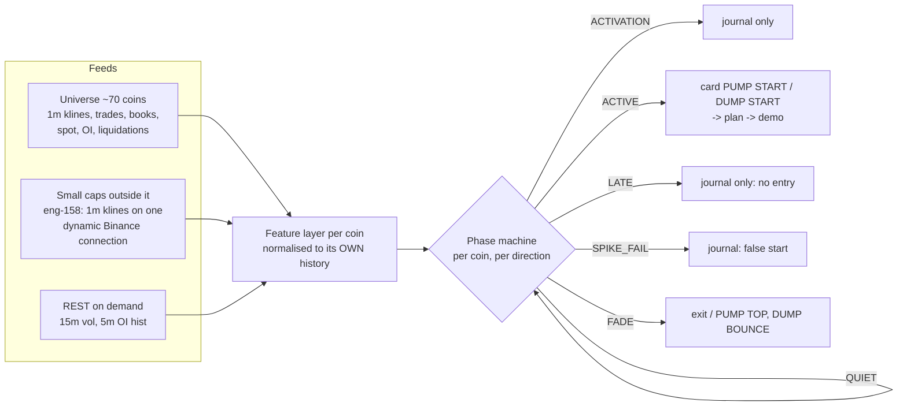

# Pump / dump start detector - scheme (2026-10-24)

Built from the owner's web research (Kamps & Kleinberg 2018, Fantazzini & Xiao 2023, Scaillet et al. 2018,
Li-Shin-Wang 2025, aleks-ent/pump-dump-crypto-screener rules) and mapped onto what edgehunter already has
(eng-157 DUMP START, eng-158 small-cap 1m watch). Numbers marked *screener* are that project's heuristics, not
measured results - they enter as journaled features first, the live journal decides.

## 1. Data flow

## 2. Features (each vs the coin's own last 24h)

| Feature | Formula | Have it? |
|---|---|---|
| volume_ratio (1m, 5m) | quote vol / **median** of the previous 24h same TF | partly: rvol_1m vs 24h **mean** |
| volume cluster | candles with volume_ratio >= 3 among the last 4 (5m) | no |
| range_ratio | (high-low)/close / median of 24h | no |
| move 3 / 6 candles (5m) | close / close[-3], close[-6] - 1 | partly: 15m move >= max(3%, 4 sigma) |
| return_z | 15m return / 15m sigma | yes (pump_start_z) |
| breakout | close > max high of the previous 24 x 5m (2h) by 0.3% *screener* | partly: fresh 24h high/low |
| quiet before | 2-6h range and volume below their medians | partly: `quiet` window (45m) |
| taker_imbalance 1/5/15m | (buy - sell) / (buy + sell) | universe: spot + futures; small caps: futures only |
| OI change 5m / 1h | open interest | yes (5m) |
| cross-venue | same direction on >= 2 other venues | universe only (venue flows) |
| spread / depth imbalance | book | universe only |
| liquidations | forceOrder (incomplete feed) | universe only - context, never a trigger |

## 3. Phase machine (one per coin and direction; dump = mirror)

| Phase | Enter when | Action |
|---|---|---|
| QUIET | default | - |
| ACTIVATION | 1m: volume_ratio >= 3 and range_ratio >= 1.5 and move in direction *screener* | journal `activation_ts` (lead time) |
| ACTIVE (= PUMP / DUMP START) | 5m: volume cluster >= 2 of 4, move3 >= 2% or move6 >= 4% *screener*, breakout of the 2h range, taker imbalance with the move, OI rising | card -> plan -> demo (today's trigger, plus the new fields) |
| LATE | move over 12 x 5m >= 12% with volume_ratio >= 10 and range_ratio >= 4 *screener* | journal only, **no new entry** (detector sees it, entry too late) |
| SPIKE_FAIL | one 5m candle >= 5% then >= 70% of it retraced within 2 candles *screener* | journal `false_start`, cancels a waiting card |
| FADE | pump: strong opposite candle on high volume, close back below the breakout / EMA20, or retrace >= 50% of the leg; dump: mirror | exit / feeds PUMP TOP, DUMP BOUNCE SHORT |

Rules kept from the research: never one feature alone; volume without direction is not a pump; a liquidation burst
classifies a running move, it does not predict one; LATE is a separate state from ACTIVE.

## 4. What changes vs today

1. Baselines: median of the previous 24h (288 x 5m / 1440 x 1m) instead of the 24h mean - one spike no longer
   inflates the base.
2. A 5m layer next to the 15m gate: volume cluster, range_ratio, move3 / move6, 2h breakout.
3. Two new journaled states: LATE (blocks entry) and SPIKE_FAIL (false start); ACTIVATION timestamp for lead time.
4. Small caps: futures taker imbalance is the flow input (no spot), flagged `flow_src = futures`.
5. Every feature journaled on the card (`pd_*` columns) so the journal shows which ones paid - first as shadow
   filters, promoted only on live evidence (the project's rule).

## 5. Timing honesty (no lookahead)

- A 5m feature exists at the candle's CLOSE; the entry is the next tick after it (the card's confirm entry).
- Journal three times: first feature seen, signal formed, order filled (BingX fill) - lead time and slippage.
- Liquidations and OI arrive late (REST 5m OI): context only.

## 6. Budget

Small caps: ring 180 x 1m per coin (~7 MB / 150 coins); 5m features from the ring (no new stream); medians need
24h -> one REST 5m klines call (288) per coin per hour, cached (~150 calls/h, weight 2). No books / trades for
small caps (memory / connections).
